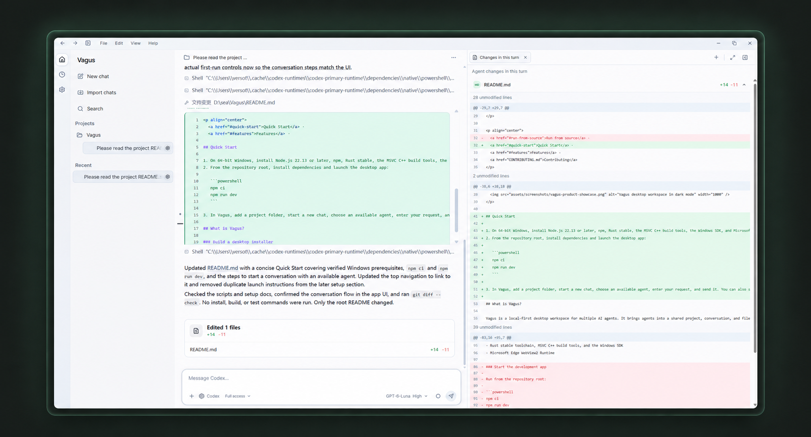
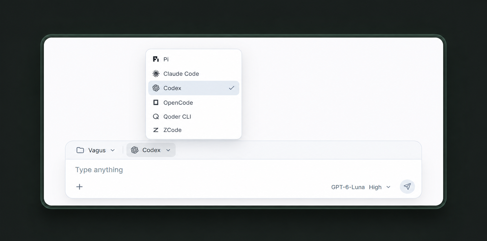

<p align="center">
  
</p>

<h1 align="center">Vagus</h1>

<p align="center">
  <strong>Ein Desktop-Arbeitsbereich für die Agents, die du bereits nutzt</strong><br />
  Projekte, Unterhaltungen, Agent-Aktivität und Codeänderungen an einem Ort.
</p>

<p align="center"><a href="README.md">English</a> · <a href="README.zh-CN.md">简体中文</a> · <a href="README.zh-TW.md">繁體中文</a> · <a href="README.es.md">Español</a> · <a href="README.ja.md">日本語</a> · <a href="README.ko.md">한국어</a> · <a href="README.pt-BR.md">Português (Brasil)</a> · <a href="README.fr.md">Français</a> · Deutsch · <a href="README.ru.md">Русский</a> · <a href="README.vi.md">Tiếng Việt</a></p>

<p align="center">
  
  <a href="LICENSE"></a>
  
</p>

<p align="center">
  
</p>

<p align="center"><sub>Unterhaltung und Dateiänderungen nebeneinander.</sub></p>

## Ein Arbeitsbereich für deine Coding-Agents

Vagus bringt Projekte und Agent-Unterhaltungen in einem Desktop-Arbeitsbereich zusammen. Wähle einen Agent, verfolge seine Arbeit, prüfe Dateiänderungen neben der Unterhaltung und kehre jederzeit zu früheren Sitzungen zurück. Agent-CLIs, Konten und Modelle bleiben auf deinem Rechner konfiguriert.

## Funktionen

- **Den passenden Agent wählen.** Pi, Claude Code, Codex, OpenCode, Qoder CLI oder ZCode im selben Projekt nutzen – mit den Modellen und Modi, die die jeweilige Integration anbietet.
- **Den Arbeitsweg mitverfolgen.** Laufende Antworten, Werkzeugaktivität und Ausführungsstatus direkt in der Unterhaltung sehen.
- **Änderungen im Kontext prüfen.** Geänderte Dateien pro Schritt anzeigen und den vollständigen Diff neben der Unterhaltung öffnen.
- **Werkzeuge griffbereit halten.** Datei-, Terminal-, Browser- und Review-Tabs im Desktop-Arbeitsbereich öffnen.
- **Frühere Arbeit wiederfinden.** Unterhaltungen durchsuchen und native Verläufe unterstützter Agents importieren.
- **Wiederkehrende Aufgaben planen.** Lokale Zeitpläne erstellen und je Aufgabe einen verfügbaren Agent, ein Modell und einen Modus wählen.

<p align="center">
  
</p>

<p align="center"><sub>Beim Start einer Unterhaltung einen Agent auswählen.</sub></p>

### Integrierte Agenten

| Agent | Integration | Hinweise |
| --- | --- | --- |
| Pi | Pi RPC | Unterstützt Pi-Erweiterungen und den nativen Import von Gesprächen. |
| Claude Code | ACP-Bridge | Die lokale Claude-Code-CLI verwaltet Installation, Anmeldung und Benutzereinstellungen. |
| Codex | Codex app-server | Verwendet die lokale Codex-CLI; app-server ist weiterhin eine experimentelle Schnittstelle. |
| OpenCode | ACP | Nutzt Sitzungsfunktionen, die von der lokalen OpenCode-CLI bereitgestellt werden. |
| Qoder CLI | ACP | Nutzt Funktionen, die von der lokalen Qoder-CLI bereitgestellt werden. |
| ZCode | ACP-Bridge | Verbindung über den Community-Server `zcode-acp-server`; keine offizielle Z.ai-ACP-Integration. |

Die offiziellen Tools der Agenten verwalten Installation, Konto und Modellkonfiguration. Vagus meldet Sie nicht stellvertretend an und garantiert keine Funktionen, die ein Agent nicht über sein Integrationsprotokoll bereitstellt.

## Plattformen

Vagus bereitet die Beta-Phase vor; der erste Installer wurde noch nicht veröffentlicht. Der Release-Workflow ist für Windows x64 sowie macOS Intel und Apple silicon eingerichtet. Codesignierung und macOS-Notarisierung sind nicht konfiguriert; die macOS-Pakete wurden noch keiner Release-Abnahme unterzogen. Linux wird derzeit nicht unterstützt. Ein Build-Ziel ist kein Nachweis für getestete Kompatibilität.

## Beta-Versionen und Downloads

Öffentliche Testversionen sollen als GitHub Pre-releases mit Versionsnummern wie `0.1.0-beta.1` erscheinen. Auf jeder Release-Seite finden Sie Installer, Versionshinweise und bekannte Probleme. Sichern Sie wichtige Daten vor dem Test und nennen Sie bei Fehlerberichten Ihre Vagus-Version und Ihr Betriebssystem.

Die Desktop-App verwendet das lokale Node.js, um Vagus Host auszuführen, und benötigt Node.js 22.13 oder höher. Nutzer installieren, konfigurieren und authentifizieren die benötigten Agent-CLIs selbst. Die Installer enthalten weder Node.js noch Agent-CLIs.

Für jede Version gibt es eigene Hinweise unter [`releases/`](releases/). Dieselbe Markdown-Datei dient als Beschreibung des GitHub Release. Bisher wurde noch kein Beta-Installer veröffentlicht.

### Voraussetzungen

- 64-Bit-Windows
- Node.js 22.13 oder höher und npm
- Rust stable, MSVC-C++-Buildtools und Windows SDK
- Microsoft Edge WebView2 Runtime

Starten Sie die Entwicklungs-App im Repository-Stammverzeichnis:

```powershell
npm ci
npm run dev
```

Desktop-Installer erstellen:

```powershell
npm run build:desktop
```

### Änderungen überprüfen

```powershell
npm run test:stage-one
npm run build:app
cargo test --locked --manifest-path packages/desktop/src-tauri/Cargo.toml
```

Automatisierte Qualitätsprüfungen laufen derzeit unter Windows CI. Ein erfolgreicher CI-Lauf bedeutet nicht, dass alle Agent-Versionen, Rechnerkonfigurationen und Plattformen Ende-zu-Ende geprüft wurden.

## Mitwirken

Fehlerberichte und Verbesserungsvorschläge sind willkommen. Lesen Sie den [Leitfaden für Beiträge](CONTRIBUTING.md) und verwenden Sie die [Issue-Vorlagen](.github/ISSUE_TEMPLATE/) oder die [Pull-Request-Vorlage](.github/PULL_REQUEST_TEMPLATE.md). Stellen Sie vor dem Einreichen von Bildern, Symbolen, Schriftarten, Code oder Dokumentation sicher, dass eine Weiterverbreitung zulässig ist, und nennen Sie Quelle und Lizenz.

## Lizenz

Der ursprüngliche Vagus-Code steht unter der [Apache License 2.0](LICENSE). Für Abhängigkeiten und Ressourcen gelten die jeweiligen Lizenzen der Upstream-Projekte. Agent-Marken gehören den jeweiligen Rechteinhabern und sind nicht durch die Vagus-Lizenz lizenziert.
