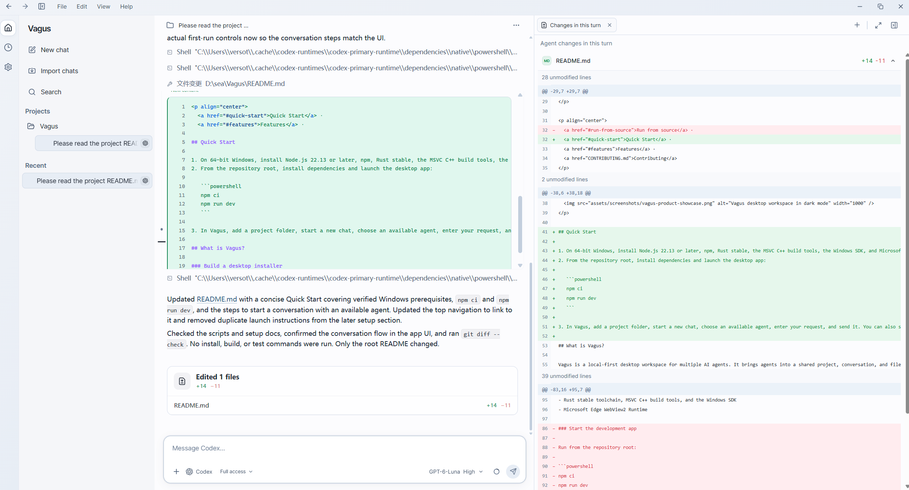
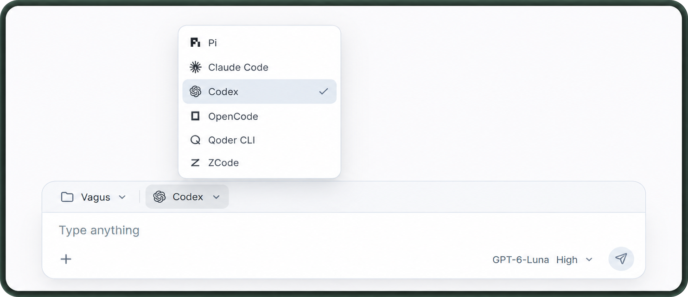

<p align="center">
  
</p>

<h1 align="center">Vagus</h1>

<p align="center">
  <strong>Một không gian làm việc cho các Agent bạn đang dùng</strong><br />
  Đưa dự án, hội thoại, hoạt động của Agent và thay đổi mã vào cùng một nơi.
</p>

<p align="center"><a href="README.md">English</a> · <a href="README.zh-CN.md">简体中文</a> · <a href="README.zh-TW.md">繁體中文</a> · <a href="README.es.md">Español</a> · <a href="README.ja.md">日本語</a> · <a href="README.ko.md">한국어</a> · <a href="README.pt-BR.md">Português (Brasil)</a> · <a href="README.fr.md">Français</a> · <a href="README.de.md">Deutsch</a> · <a href="README.ru.md">Русский</a> · Tiếng Việt</p>

<p align="center">
  
  <a href="LICENSE"></a>
  
</p>

<p align="center">
  
</p>

<p align="center"><sub>Hội thoại và thay đổi tệp đặt cạnh nhau.</sub></p>

## Không gian làm việc cho các Agent lập trình

Vagus đưa dự án và hội thoại với Agent vào cùng một không gian làm việc trên máy tính. Bạn có thể chọn Agent, theo dõi công việc theo thời gian thực, xem thay đổi tệp bên cạnh hội thoại và quay lại phiên trước đó. CLI, tài khoản và mô hình của Agent vẫn do bạn cấu hình trên máy của mình.

## Tính năng

- **Chọn Agent phù hợp với công việc.** Dùng Pi, Claude Code, Codex, OpenCode, Qoder CLI hoặc ZCode trong cùng một dự án, với các mô hình và chế độ mà từng tích hợp cung cấp.
- **Theo dõi cả quá trình.** Xem phản hồi trực tiếp, hoạt động công cụ và trạng thái thực thi ngay trong hội thoại.
- **Xem thay đổi theo ngữ cảnh.** Xem các tệp được sửa ở mỗi lượt và mở toàn bộ diff bên cạnh hội thoại.
- **Giữ công cụ cần thiết trong tầm tay.** Mở thẻ tệp, terminal, trình duyệt và xem thay đổi trong không gian làm việc.
- **Quay lại công việc trước đó.** Tìm kiếm hội thoại và nhập lịch sử gốc từ các Agent hỗ trợ tính năng này.
- **Lên lịch công việc lặp lại.** Tạo tác vụ cục bộ theo lịch và chọn Agent, mô hình, chế độ khả dụng cho từng tác vụ.

<p align="center">
  
</p>

<p align="center"><sub>Chọn Agent khi bắt đầu hội thoại.</sub></p>

### Agent được tích hợp

| Agent       | Cách tích hợp    | Ghi chú                                                                                               |
| ----------- | ---------------- | ----------------------------------------------------------------------------------------------------- |
| Pi          | Pi RPC           | Hỗ trợ tương tác với extension Pi và nhập hội thoại gốc.                                              |
| Claude Code | Cầu nối ACP      | CLI Claude Code cục bộ quản lý cài đặt, đăng nhập và cấu hình người dùng.                             |
| Codex       | Codex app-server | Dùng CLI Codex cục bộ; app-server vẫn là giao diện thử nghiệm.                                        |
| OpenCode    | ACP              | Dùng khả năng phiên làm việc do CLI OpenCode cục bộ cung cấp.                                         |
| Qoder CLI   | ACP              | Dùng các khả năng do CLI Qoder cục bộ cung cấp.                                                       |
| ZCode       | Cầu nối ACP      | Kết nối qua `zcode-acp-server` do cộng đồng duy trì; đây không phải tích hợp ACP chính thức của Z.ai. |

Công cụ chính thức của từng Agent quản lý việc cài đặt, tài khoản và cấu hình mô hình. Vagus không đăng nhập thay bạn và không đảm bảo các tính năng mà Agent không công bố qua giao thức tích hợp.

## Nền tảng

Vagus đang trong giai đoạn Beta công khai. Bản phát hành đầu tiên có bộ cài cho Windows x64, macOS Intel và Apple silicon. Chưa cấu hình ký mã hoặc notarization cho macOS; các gói macOS chưa qua kiểm định phát hành. Hiện chưa hỗ trợ Linux.

## Bản Beta và tải xuống

Bản thử nghiệm công khai đầu tiên có thể tải tại [Vagus v0.1.0-beta.1](https://github.com/versot/Vagus/releases/tag/v0.1.0-beta.1). Mỗi trang GitHub Pre-release liệt kê bộ cài, ghi chú thay đổi và các vấn đề đã biết. Hãy sao lưu dữ liệu quan trọng trước khi thử nghiệm và ghi rõ phiên bản Vagus cùng hệ điều hành khi báo lỗi.

Ứng dụng desktop dùng Node.js cục bộ để chạy Vagus Host và cần Node.js 22.13 trở lên. Người dùng tự cài đặt, đăng nhập và cấu hình các CLI Agent cần thiết. Bộ cài không bao gồm Node.js hoặc CLI của Agent.

Mỗi phiên bản có tệp ghi chú riêng trong [`releases/`](releases/); cùng tệp Markdown đó được dùng làm nội dung GitHub Release.

### Yêu cầu

- Windows 64-bit
- Node.js 22.13 trở lên và npm
- Rust stable, công cụ build C++ MSVC và Windows SDK
- Microsoft Edge WebView2 Runtime

Chạy ứng dụng phát triển từ thư mục gốc của repository:

```powershell
npm ci
npm run dev
```

Build bộ cài desktop:

```powershell
npm run build:desktop
```

### Kiểm tra thay đổi

```powershell
npm run test:stage-one
npm run build:app
cargo test --locked --manifest-path packages/desktop/src-tauri/Cargo.toml
```

Các bước kiểm tra tự động hiện chạy trên Windows CI. CI thành công không có nghĩa mọi phiên bản Agent, cấu hình máy hoặc nền tảng đã được xác minh đầu-cuối.

## Đóng góp

Chúng tôi hoan nghênh báo lỗi và đề xuất cải tiến. Vui lòng đọc [hướng dẫn đóng góp](CONTRIBUTING.md), đồng thời dùng [mẫu Issue](.github/ISSUE_TEMPLATE/) hoặc [mẫu Pull Request](.github/PULL_REQUEST_TEMPLATE.md). Trước khi gửi hình ảnh, biểu tượng, phông chữ, mã nguồn hoặc tài liệu, hãy xác nhận quyền phân phối lại và ghi rõ nguồn cùng giấy phép.

## Giấy phép

Mã nguồn gốc của Vagus được cấp phép theo [Apache License 2.0](LICENSE). Các dependency và tài nguyên tuân theo giấy phép của dự án upstream tương ứng. Nhãn hiệu của Agent thuộc về chủ sở hữu tương ứng và không được cấp phép theo giấy phép Vagus.
